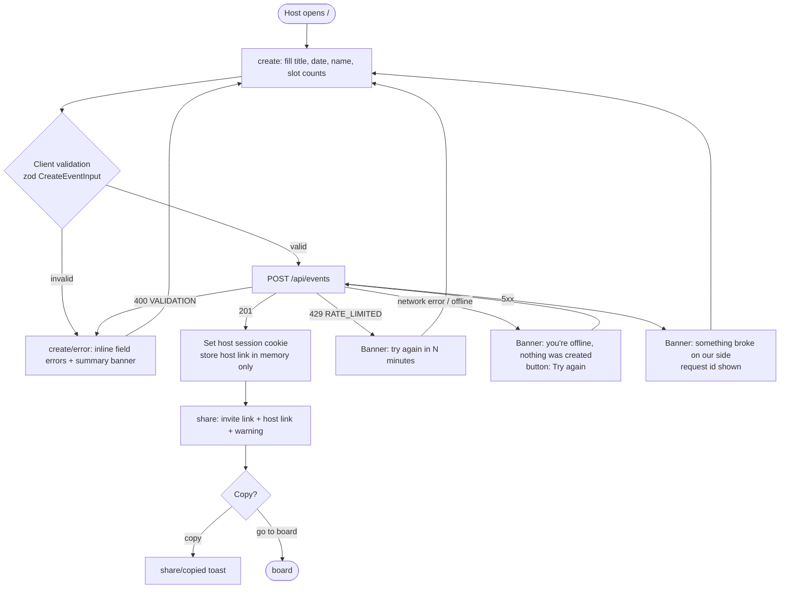
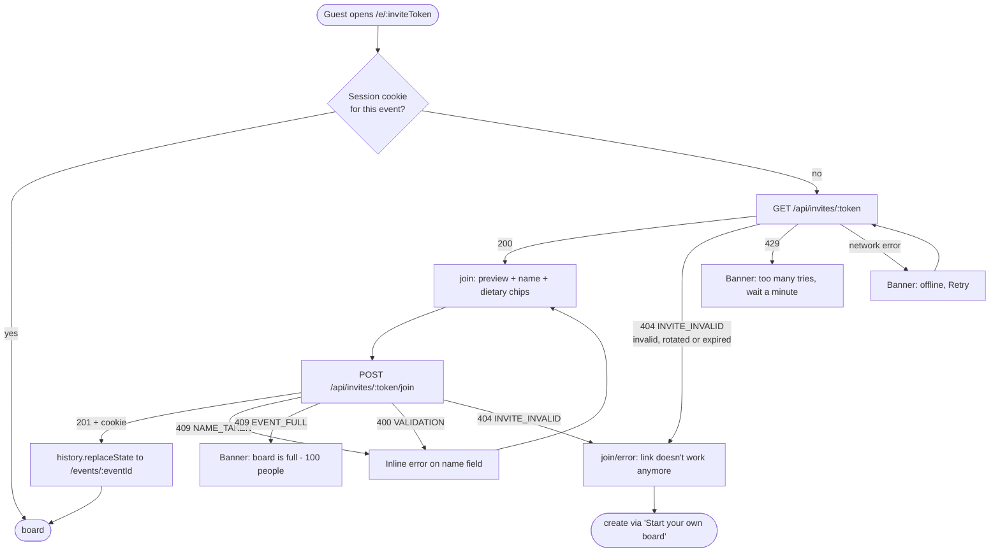
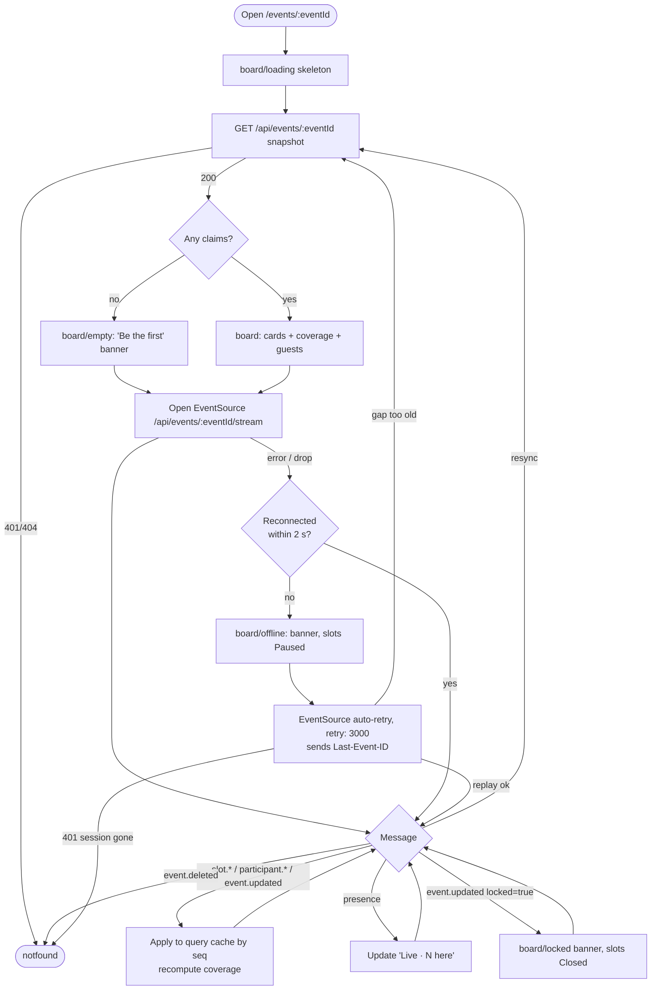
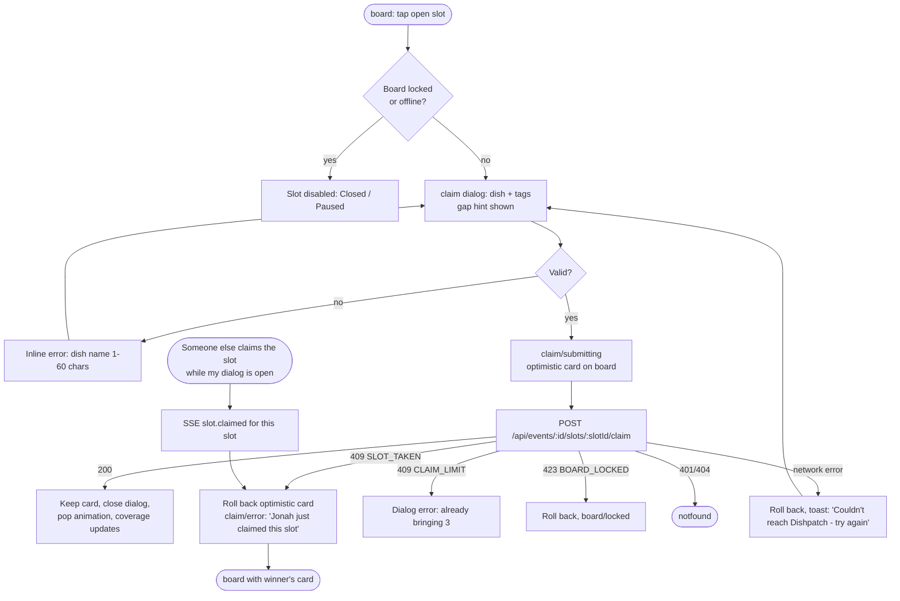
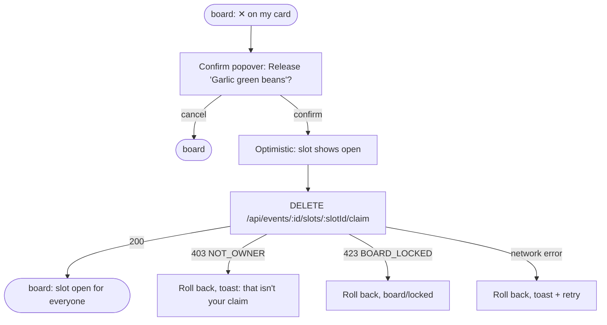
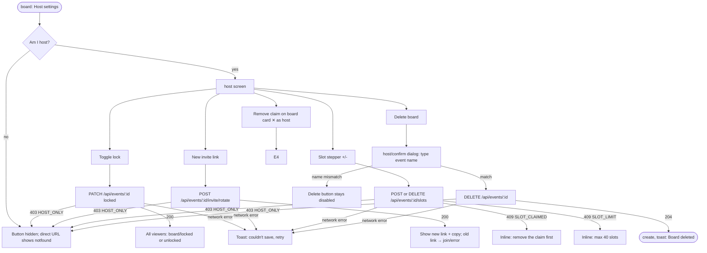
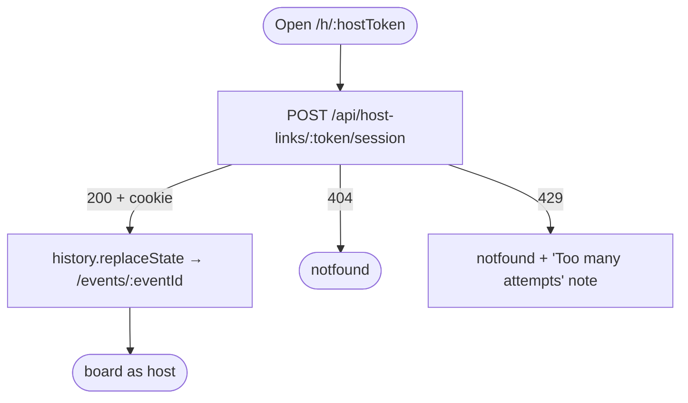
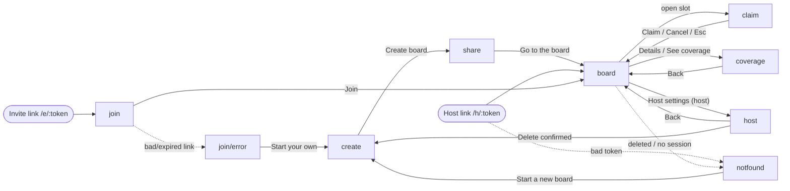

# 02 · User flows — Dishpatch

> Role: UX. Screen ids match `design/mockup.html#<id>` and `design/screens/<id>.png`.

## Screen / page inventory

| id | Name | Route (SPA) | Purpose | Entry points | Features |
|---|---|---|---|---|---|
| `create` | Create board | `/` | Landing + form to create a board with slot counts | Direct visit, "Start a new board" on notfound/join error | F1 |
| `share` | Share links | `/events/:eventId/share` | Shows the guest invite link and the one-time host link | After successful create | F1 |
| `join` | Join board | `/e/:inviteToken` | Event preview, name + dietary needs form | Invite link from chat | F2 |
| `board` | Live board | `/events/:eventId` | Slots by category, claims, live status, coverage sidebar (desktop), guest list | After join/create, returning visit with session cookie, host link | F3, F4, F5 |
| `claim` | Claim dialog | `/events/:eventId?claim=:slotId` (modal over board) | Dish name + tags for one open slot | Tap/click an open slot | F4, F5 |
| `coverage` | Dietary coverage | `/events/:eventId/coverage` | Full per-need breakdown + rules | Sidebar "Details →" (desktop), banner "See coverage" (mobile) | F5 |
| `host` | Host settings | `/events/:eventId/host` | Lock, rotate invite, edit slots, delete | "Host settings" button (host only) | F6 |
| `notfound` | Not found | any unknown route, `/h/:bad`, unauthorized board | Generic "nothing on this plate", no existence leak | Bad links, deleted board, no session | F1, F2, F6 |

Host link route `/h/:hostToken` has no screen of its own: it exchanges the token for a host session and redirects to `board` (or `notfound`).

## Flow A — Host creates a board (F1 · US-01, US-02)

## Flow B — Guest joins (F2 · US-03, US-04)

## Flow C — Live board, live updates and reconnect (F3, F5 · US-05, US-06, US-10)

## Flow D — Claim a slot, including the race (F4, F5 · US-07, US-08, US-11)

## Flow E — Release my claim (F4 · US-09)

## Flow F — Host controls (F6 · US-12, US-13, US-14)

## Flow G — Host reopens the board on another device (F1 · US-02)

## Navigation map

