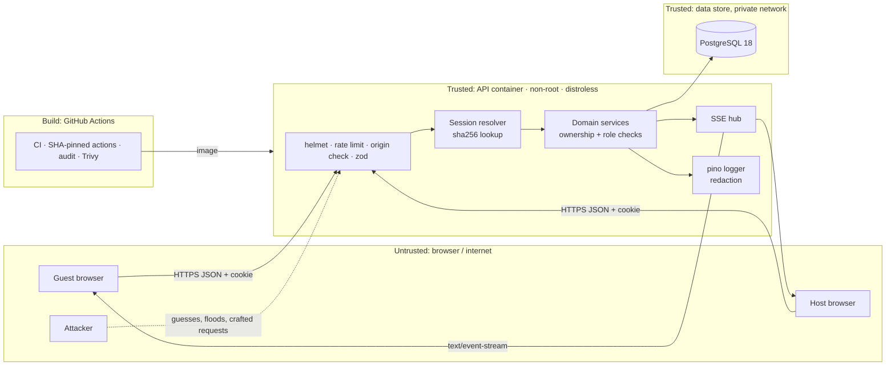

# 07 · Security — Dishpatch

> Role: Security Engineer. Checked against the OWASP Top 10:2025 (A01–A10). Every STRIDE mitigation has a named test; the test names are repeated in the matching feature in 05-features.md and in 06-test-plan.md.

## Assets

| Asset | Why it matters |
|---|---|
| Host token (`/h/<token>`) | Full control of a board: lock, remove claims, rotate invite, delete. |
| Invite token (`/e/<token>`) | Lets anyone join the board and see names + dietary needs. |
| Session cookies (`dp_sess`) | Act as a participant (claim/release) or host. |
| Participant data | Display names, dietary needs (can hint at religion — halal — or health — gluten-free), dish names. |
| Board integrity | Claims must reflect what people actually signed up for; no double claims, no tampering by others. |
| Availability of the stream | A board people rely on the day before the party. |
| CI/CD and dependencies | A compromised action or package could ship a backdoor. |

## Actors

- **Host** (trusted for their own board), **Guest** (trusted for their own claims), **Anonymous visitor** (has no token), **Link holder** (got an invite link forwarded — treated as a guest by design), **Attacker on the internet** (token guessing, DoS, XSS/CSRF attempts), **Malicious participant** (has a valid guest session, tries to act on others' claims or host functions), **Supply-chain attacker**.

## Trust boundaries / data flow



Boundary rules: everything crossing TB1→TB2 is validated by a Zod schema and passes rate limiting; only the session resolver turns a cookie into an `Actor {participantId, eventId, role}`; domain services take an `Actor`, never raw ids from the client, for authorization.

## STRIDE threat model

| ID | Threat | Component | Mitigation | Verifying test |
|---|---|---|---|---|
| S1 | Guessing invite/host tokens | `/api/invites/*`, `/api/host-links/*` | 32 random bytes (256 bits) base64url; only SHA-256 hash stored; constant-time lookup by hash; 30/min (preview), 10/min (join, host link) per IP | `tokens.test.ts › generateToken returns 43-char base64url from 32 random bytes`; `invites.int.test.ts › preview is rate limited after 30 requests per minute`; `host-links.int.test.ts › 11th host-link attempt in a minute returns 429` |
| S2 | Session theft via XSS | web, cookies | `HttpOnly` cookie, strict CSP (no inline script), React escaping, no `dangerouslySetInnerHTML` (Biome rule) | `security-headers.int.test.ts › CSP has script-src 'self' and no unsafe-inline`; `session.int.test.ts › session cookie is HttpOnly, SameSite=Strict and Path-scoped to the event`; `xss.spec.ts › dish name with  renders as text` |
| S3 | Pretending to be another guest by name | join | Unique `(event_id, lower(display_name))`; claims bound to participant id | `join.int.test.ts › rejects case-insensitive duplicate name with 409 NAME_TAKEN` |
| T1 | Releasing/editing someone else's claim | `DELETE …/claim` | Ownership check (`claimed_by = actor.participantId` or `actor.role = host`) | `claims.int.test.ts › release by non-owner returns 403 NOT_OWNER and slot is unchanged` |
| T2 | CSRF on mutations | all non-GET routes | `SameSite=Strict` cookie + `Origin` must equal `APP_ORIGIN` + JSON-only bodies (415 otherwise) | `origin-check.int.test.ts › rejects POST with foreign Origin with 403 BAD_ORIGIN`; `origin-check.int.test.ts › rejects form-encoded body with 415` |
| T3 | SQL injection via dish/name/title | DB layer | Drizzle / postgres.js parameterised queries only; no string-built SQL (`pnpm lint:sql` fails CI on `sql.raw(` / `.unsafe(` in `apps/api/src`); Zod length/charset limits | `claims.int.test.ts › dish name with SQL metacharacters is stored verbatim` |
| T4 | Double-claim through a race | claim service | Event-row `FOR UPDATE` + conditional `UPDATE … WHERE claimed_by IS NULL` + CHECK constraint | `claim.race.int.test.ts › 50 concurrent claims on one slot yield exactly one 200`; `claim.race.int.test.ts › claim limit holds under 10 concurrent claims by one participant` |
| T5 | Tampering with tags/needs values | schemas, DB | Zod enum + DB `CHECK (… <@ ARRAY[…])` | `schemas.test.ts › rejects unknown dietary value`; `db-constraints.int.test.ts › DB rejects unknown dish tag even if service is bypassed` |
| R1 | Host denies removing a claim / locking | host actions | `event_log` row per mutation with `actorId` + `actorRole`; request id in every log line | `host.int.test.ts › host removing a claim writes slot.released with actorRole host` |
| I1 | Enumerating boards by id | `/api/events/:id*` | UUIDv4 ids; no-session and wrong-event both return 404 (never 403) | `snapshot.int.test.ts › returns 404 (not 403) without a session for an existing event` |
| I2 | Tokens leaking via logs, Referer or history | logger, headers, web | pino redaction of `/e/*`, `/h/*`, `/api/invites/*`, `/api/host-links/*`, `cookie`, `set-cookie`; `Referrer-Policy: no-referrer`; `history.replaceState` after exchange; host link never stored in localStorage | `logging.test.ts › redacts invite and host tokens from request logs`; `security-headers.int.test.ts › sets Referrer-Policy no-referrer`; `join.spec.ts › address bar no longer contains the invite token after joining` |
| I3 | Reading another board's stream | SSE | Session resolver checks `session.eventId = :eventId`; cookie `Path=/api/events/<id>` | `stream.int.test.ts › stream for event B with a session of event A returns 404` |
| I4 | Exposing dietary needs beyond the board | API, logs | Needs only in snapshot/stream of the same board; request bodies never logged; deleted with the board | `logging.test.ts › does not log request bodies`; `cleanup.int.test.ts › deletes events 14 days after starts_at with all participants` |
| I5 | Stack traces / internals in errors | error handler | Central error handler maps known errors to codes; unknown → 500 `INTERNAL` with `requestId` only | `errors.int.test.ts › 500 response has no stack trace and includes requestId` |
| D1 | Exhausting SSE connections | SSE hub | ≤ 5 streams/session, ≤ 20/IP, heartbeat 20 s, close sockets of deleted events, server `keepAliveTimeout` | `stream.int.test.ts › 6th concurrent stream for one session returns 429 TOO_MANY_STREAMS` |
| D2 | Create-event spam | `POST /api/events` | 5/hour/IP; total slots ≤ 40 | `events.int.test.ts › 6th create within an hour from one IP returns 429` |
| D3 | Oversized payloads | all bodies | `express.json({ limit: '16kb' })` (413 on overflow); Zod `.max()` on every string/array | `events.int.test.ts › rejects body over 16 KB with 413`; `schemas.test.ts › rejects title over 80 characters` |
| E1 | Guest calls host endpoints | `PATCH`, slots, rotate, delete | `requireHost(actor)` guard in domain service, not just hidden UI | `host.int.test.ts › guest PATCH lock returns 403 HOST_ONLY` |
| E2 | Old invite still works after rotation | rotate | New `invite_token_hash` replaces the old one atomically | `host.int.test.ts › rotated-out invite token returns 404 on preview and join` |
| E3 | Compromised dependency or CI action | CI/CD | Lockfile + `pnpm install --frozen-lockfile`; `pnpm audit --audit-level high`; actions pinned by full SHA; Trivy image scan; Dependabot weekly | CI jobs `deps-audit` and `image-scan` must pass (06-test-plan.md quality gates) |

## OWASP Top 10:2025 checklist

| Category | Applies? | How it's handled |
|---|---|---|
| A01 Broken Access Control | ✅ | Per-event session; ownership checks on release; `requireHost` on host routes; 404 for foreign boards (S3, T1, I1, I3, E1, E2). |
| A02 Security Misconfiguration | ✅ | helmet with explicit CSP; no CORS (same origin); `x-powered-by` off (`app.disable('x-powered-by')`); Express `trust proxy` setting only via env; non-root distroless image; no default credentials (compose reads `.env`). |
| A03 Software Supply Chain Failures | ✅ | Frozen lockfile, `pnpm audit`, SHA-pinned actions, Trivy image scan, Dependabot, minimal deps (stack table only) (E3). |
| A04 Cryptographic Failures | ✅ | 256-bit tokens from `crypto.randomBytes`; SHA-256 at rest (tokens are high-entropy, so a slow password hash isn't needed); HTTPS + HSTS in prod; `Secure` cookies. |
| A05 Injection | ✅ | Parameterised SQL only; Zod validation; React output encoding; CSP as defence in depth (T3, S2). |
| A06 Insecure Design | ✅ | Race-safe claim by design (T4); limits per event/participant; capability-link model documented with its trade-offs below. |
| A07 Authentication Failures | ✅ | No passwords; token exchange rate-limited; session cookie hardened; sessions expire with the event; host link shown once. |
| A08 Software or Data Integrity Failures | ✅ | DB CHECK constraints mirror Zod (T5); migrations reviewed and committed; event log is append-only from the app's point of view. |
| A09 Security Logging & Alerting Failures | ✅ | Structured logs with request id; 4xx auth/rate-limit events logged at `warn` with route + code (no tokens, no bodies); host actions in `event_log` (R1). Alerting is out of scope for a local MVP — noted. |
| A10 Mishandling of Exceptional Conditions | ✅ | Central error handler (I5); transactions roll back on any throw; SSE publish only after commit; client rolls back optimistic state on every non-2xx/timeout; DB/stream failures show user-friendly banners. |
| OWASP MASVS | N/A | Web-only project; no native mobile app. |

## Concrete settings

**Authentication & sessions**
- Tokens: `crypto.randomBytes(32).toString('base64url')`; stored as `sha256(token)` (`bytea`); compared via unique index lookup (no early-exit string compare in JS).
- Cookie `dp_sess`: `HttpOnly; SameSite=Strict; Path=/api/events/<eventId>; Max-Age=<seconds until expires_at>; Secure` when `COOKIE_SECURE=true`. A new session row is created per join / host-link exchange.
- Host link shown once on `share`; never written to storage; can be re-used to create more host sessions (by design, so the host can switch devices).
- Password hashing (argon2/bcrypt): **N/A** — the app has no passwords.

**Authorization**
- `resolveActor(req, eventId)` → `Actor | null`; `null` → 404. `requireHost(actor)` → 403 `HOST_ONLY`. Release: owner or host.

**Input validation & output encoding**
- Zod schemas in `packages/shared/src/schemas.ts` for every body/param; strings trimmed, length-limited, control characters rejected (`/^[^\p{Cc}]+$/u`).
- React escapes output; Biome `noDangerouslySetInnerHtml` = error.

**CORS / CSRF**
- No CORS middleware registered (same origin). CSRF: SameSite=Strict + Origin check on POST/PATCH/DELETE + `content-type: application/json` only.

**Security headers (helmet)**
```
Content-Security-Policy: default-src 'self'; script-src 'self'; style-src 'self'; font-src 'self'; img-src 'self' data:; connect-src 'self'; frame-ancestors 'none'; base-uri 'none'; form-action 'self'; object-src 'none'
Referrer-Policy: no-referrer
Strict-Transport-Security: max-age=31536000; includeSubDomains   (production only)
X-Content-Type-Options: nosniff
Cross-Origin-Opener-Policy: same-origin
Cross-Origin-Resource-Policy: same-origin
Permissions-Policy: camera=(), microphone=(), geolocation=()
Cache-Control: no-store   (all /api responses)
```
Tailwind output is a static CSS file, so `style-src 'self'` works without `unsafe-inline`.

**Rate limiting** — express-rate-limit, in-memory store, keyed by IP (or session id where noted) with the limits in 04-architecture.md. Session-keyed limits use a custom `keyGenerator` that falls back to `ipKeyGenerator(req.ip)` (express-rate-limit 8 rejects raw IPv6 keys). `TRUST_PROXY=false` by default so `X-Forwarded-For` can't be spoofed locally; behind a reverse proxy it is the hop count (`1`), so only the address the proxy saw counts (`events.int.test.ts › behind one trusted proxy, a spoofed X-Forwarded-For does not reset the create limit`). `true` (trust every hop) is for the E2E stack only.

**SQL injection prevention** — Drizzle query builder / postgres.js tagged templates only; `sql.raw(` and `.unsafe(` are banned by the `lint:sql` script (`! grep -rnE "sql\.raw\(|\.unsafe\(" apps/api/src`) that runs in CI, plus code review.

**File uploads** — N/A (no uploads in MVP). Body limit 16 KB.

**Secrets** — only via env (`env.ts` validates); `.env` git-ignored; `.env.example` has placeholders; no secrets in the client bundle (Vite only exposes `VITE_*`, none are used).

**Containers** — multi-stage build; runtime `gcr.io/distroless/nodejs24-debian13:nonroot` (uid 65532, no shell); `read_only: true` + `tmpfs: /tmp` in compose; images pinned by digest; Trivy scan fails CI on HIGH/CRITICAL with a fix available.

**Dependency scanning** — `pnpm audit --audit-level high` in CI; Dependabot for npm + GitHub Actions + Docker weekly; CodeQL (javascript-typescript) on push to main.

**Logging** — pino-http with pino `redact: ['req.headers.cookie','res.headers["set-cookie"]']` + a custom `req` serializer that replaces token path segments with `:token`; bodies never logged; log level `info` in prod.

## Capability-link model: trade-offs

Using unguessable links instead of accounts keeps joining to one step (a core goal). The cost: anyone a link is forwarded to can join, and a leaked host link gives control. Mitigations: host link shown once with a "keep it private" warning, invite rotation (F6), host can remove claims, boards auto-delete, `Referrer-Policy: no-referrer`, tokens out of logs and the address bar. Accounts/OAuth are an explicit non-goal.

## Privacy

| Data | Where | Retention |
|---|---|---|
| Event title, date, location | `events` | Deleted 14 days after `starts_at` (hourly cleanup job) or immediately on host delete |
| Display names | `participants` | Same as event |
| Dietary needs (optional) | `participants.dietary_needs` | Same as event; visible only to people on that board; join screen says so |
| Dish names + tags | `slots` | Same as event |
| Session/token hashes | `sessions`, `events` | Same as event |
| Board event history | `event_log` | 24 hours (replay window), and deleted with the event |
| IP addresses | Rate-limit memory only | Seconds–hours in RAM; never written to DB or logs |
| Request logs | stdout (container) | No IPs, tokens, bodies or names; route pattern, status, latency, request id |

Dietary needs can reveal religion or health, which GDPR treats as special-category data. They are optional, explained at the point of entry, used only for the coverage meter, never exported, and deleted with the board. No analytics, no third-party scripts or fonts.

## Security pass (M7, 2026-10-22)

- **STRIDE table:** every row's named test exists and is green (`pnpm test`, `pnpm test:int`, `pnpm test:e2e`). E3 is covered by the CI jobs `deps-audit` and `image-scan`.
- **Finding fixed:** `TRUST_PROXY` was a boolean, and `true` makes Express trust every `X-Forwarded-For` entry, so behind a real proxy a client could choose its own IP and reset every per-IP limit (S1, D1, D2). It now also takes a hop count; the README's "Deploying" section says to use `1` behind one proxy. A new test proves a spoofed header no longer resets the create limit (and fails with `true`).
- **CI gaps fixed:** the coverage gate measured 0 of 0 lines (the `include` patterns never matched, so it always passed) and the Firefox E2E project was never run. Coverage now runs over unit + integration tests in the `integration` job (shared 100% lines, domain ≥ 80%), and the `e2e` job runs `firefox-desktop` too.
- **`pnpm audit`:** 0 high/critical. Accepted: 1 moderate, `esbuild ≤ 0.24.2` (GHSA-67mh-4wv8-2f99, a dev server answering other sites) reached only through `drizzle-kit › @esbuild-kit/*`. drizzle-kit is a dev-only migration generator, its esbuild dev server is never started, and nothing from it ships in the image. Revisit when drizzle-kit drops `@esbuild-kit`.
- **Trivy (0.69.3) on the built image:** 0 high/critical; 23 medium in Debian 13 base packages (`libc6`, `libgcc-s1`, `libstdc++6`, `gcc-14-base`, `libgomp1`, `zlib1g`) with no fixed version yet. Accepted until the distroless base image picks up fixes (Dependabot watches the digest). The app's own Node packages have none.
- **Accessibility:** axe (WCAG 2.2 AA tags) now also scans the claim dialog, its conflict error, a claimed board and a locked board, in light and dark; keyboard-only create, join and claim are tested. Live announcements are throttled to one per 2 s (`use-board-stream.test.tsx`); a manual screen-reader run was not part of this pass.
