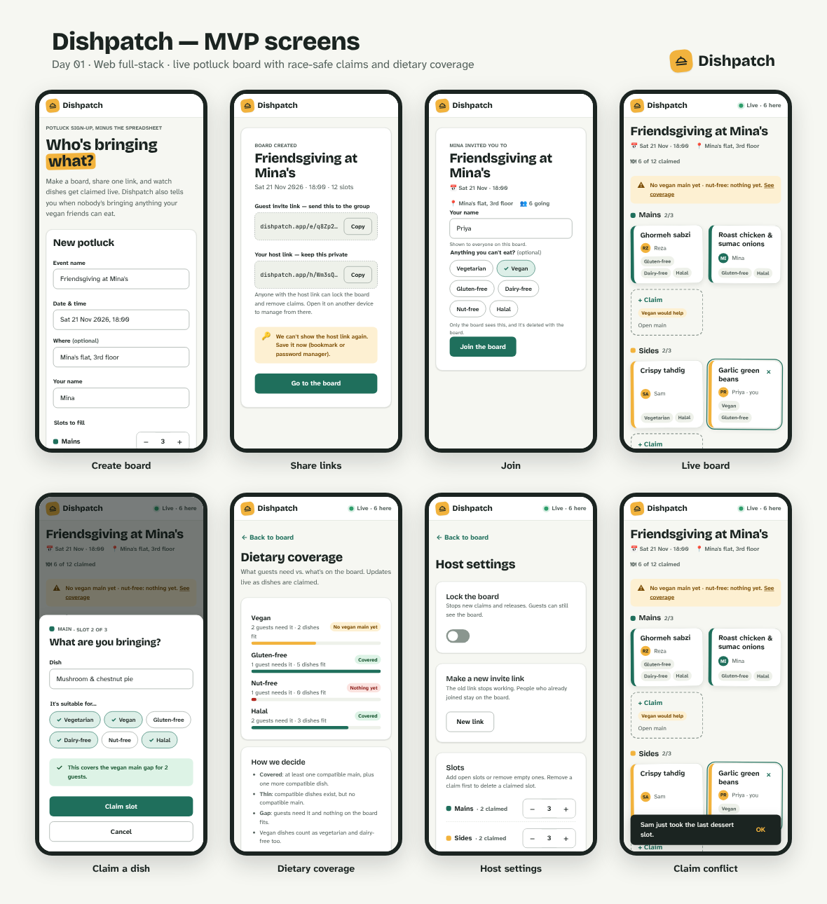
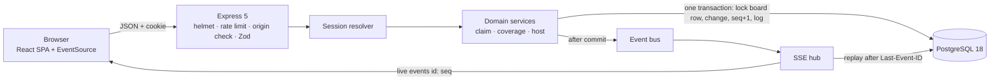
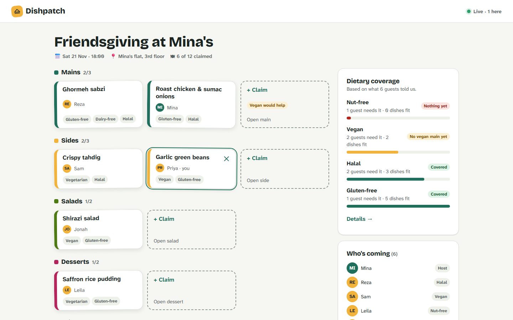
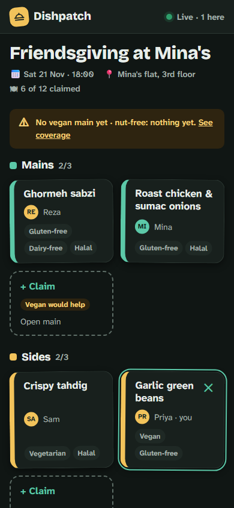
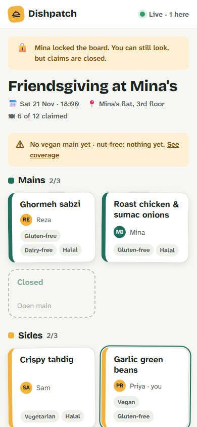
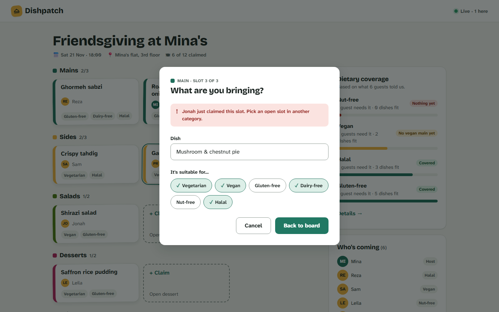
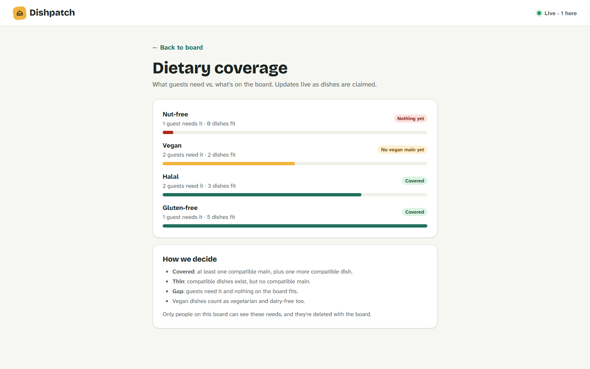
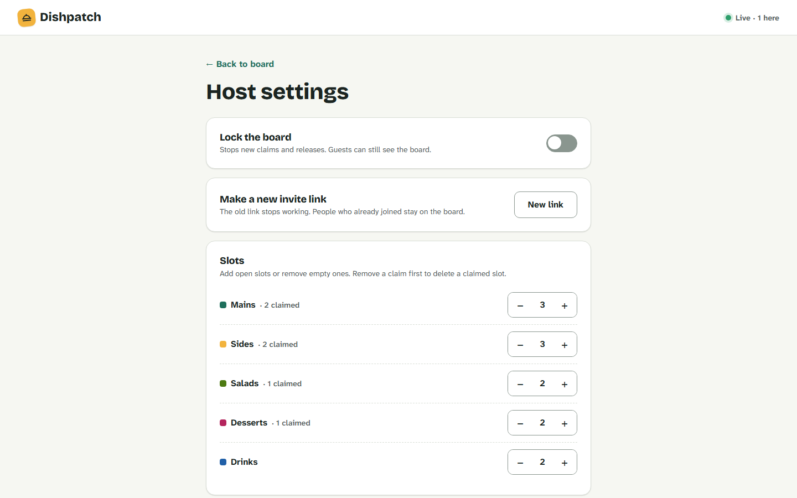

# Dishpatch

**The potluck sign-up board that updates itself — and notices when nobody's bringing the vegan main.**

Day 01 of *20 Days, 20 Projects* · Web full-stack · Difficulty: approachable · Tone: playful



## Problem

Potlucks get organised in group chats: duplicate hummus, no drinks, and the vegan guest discovering at the door that bread is dinner. Sign-up sheets help, but they want accounts, go stale until you refresh, and treat dietary needs as free-text notes nobody adds up.

## Target user

Hosts of small get-togethers (8–40 people) who share one link in a chat, and their guests, who open it on a phone and want to be done in 10 seconds. Personas: Mina (host) and Priya (vegan guest) in [01-product.md](01-product.md).

## Signature challenge

**Race-safe live claims with gap-free reconnect.** Every viewer sees claims within a second over Server-Sent Events. When two guests grab the last dessert slot at the same instant, a Postgres row lock plus a conditional `UPDATE … WHERE claimed_by IS NULL` guarantees exactly one winner, the loser's optimistic card rolls back with a clear message, and a guest whose Wi-Fi dropped replays exactly the events they missed via `Last-Event-ID` (or resyncs if the gap is too old). Proven by a 50-way concurrency test and a two-browser Playwright test. Details: [04-architecture.md › Signature challenge](04-architecture.md#signature-challenge-race-safe-live-claims-with-gap-free-reconnect).

## Features

| ID | Feature |
|---|---|
| F1 | Create a board — slots per category, guest invite link + private host link |
| F2 | Join as a guest — name + optional dietary needs, no account |
| F3 | Live board — SSE updates, presence, reconnecting state, replay on reconnect |
| F4 | Claim & release a slot — optimistic UI, exactly one winner per slot |
| F5 | Dietary coverage — needs vs. dish tags, "no vegan main yet", hints on open slots |
| F6 | Host controls — lock, remove claims, edit slots, rotate invite, delete board |

## How it's different

Existing tools: [Grasshopper Signup](https://grasshoppersignup.com/potluck-signup) (no login, real-time updates, dietary info as custom fields, email reminders), [SignUp.com](https://blog.signup.com/Potluck/Potluck-SignUp-Sheets-with-Reminders) (reminders, notes per dish; dietary needs handled with printed labels), [Perfect Potluck](https://perfectpotluck.com/blog/five-tips-for-a-perfect-potluck.php) (classic list-based sign-up).

- **Dietary needs are data, not notes.** Guests' needs and dishes' tags are compared live, so the board says "2 vegan guests, no vegan main yet" and nudges the next person who picks a main.
- **Conflicts are explicit and safe.** Simultaneous claims resolve to one winner with a named, friendly message; after a dropped connection the board catches up exactly instead of silently going stale.
- **Nothing to sign up for, nothing left behind.** Capability links instead of accounts, no email collected, and every board is hard-deleted 14 days after the event (or instantly by the host).

## Skills used today

`/tdd`, `/code-review`, `/diagnosing-bugs`, `/retro` (Matt Pocock) and a custom `design-parity` skill drafted today. Plan, fit scores and rejected options: [skills/README.md](skills/README.md).

## Why it's a good portfolio piece

- Shows a real concurrency problem solved at the right layer (database), with tests that prove it rather than claim it.
- Real-time done properly: ordering, idempotent apply, reconnect replay, presence, and connection limits.
- A complete product slice: designed states (loading/empty/error/offline/locked/conflict), dark mode, WCAG AA contrast, keyboard and screen-reader behaviour.
- Security that fits the design (capability links, path-scoped cookies, CSRF via SameSite + Origin, strict CSP, SHA-pinned CI) and privacy by default.
- Built from a written spec with AI agents, with a traceable story → test → milestone map ([08-agent-plan.md](08-agent-plan.md)).

## Run it locally

Needs Node 24.22.0 (`.nvmrc`), pnpm 12.14.0 (via Corepack) and Docker.

```bash
corepack enable && pnpm install
cp .env.example .env                       # local settings; never commit .env
docker compose up -d --build --wait        # Postgres + the API serving the built app on http://localhost:3000
```

Open http://localhost:3000, create a board, and open the invite link in a private window to join as a guest. For development with hot reload: `docker compose up -d db && pnpm db:migrate && pnpm dev` (web on :5173, API on :3000).

| Command | What it checks |
|---|---|
| `pnpm lint && pnpm lint:sql && pnpm typecheck` | Biome, banned raw SQL, TypeScript strict |
| `pnpm test` | Unit + component tests |
| `pnpm test:int` | API tests against a real Postgres (Testcontainers, needs Docker) |
| `pnpm test:cov` | Everything above with coverage thresholds (≥ 80% on shared code and domain services) |
| `pnpm --filter @dishpatch/api test:race` | The 50-way claim race |
| `docker compose -f docker-compose.yml -f docker-compose.ci.yml up -d --build --wait && pnpm test:e2e` | Playwright: two-browser real-time, race, reconnect, host flows, axe, screenshots |

CI (`.github/workflows/ci.yml`) runs all of the above plus `pnpm audit --audit-level high`, a Trivy image scan and CodeQL, with every action pinned by commit SHA.

## Architecture



One container serves both the API and the built SPA from one origin (no CORS). Full diagrams, data model and API contract: [04-architecture.md](04-architecture.md).

## Screenshots

| Board (desktop) | Board (mobile, dark) | Locked (mobile) |
|---|---|---|
|  |  |  |
| **Claim conflict** | **Dietary coverage** | **Host settings** |
|  |  |  |

Taken by `e2e/specs/visual.spec.ts` from the running app; every screen and state is compared with `design/screens/*.png`.

## Performance

Live-update latency on the local Docker stack (`e2e/specs/realtime.spec.ts`, Chromium, 20 runs each, 2026-10-21):

| Event | p50 | **p95** | max | Target |
|---|---|---|---|---|
| Guest joins → appears in another window | 18 ms | **27 ms** | 28 ms | < 500 ms |
| Slot claimed → appears in another window | 20 ms | **37 ms** | 47 ms | < 500 ms |

## Deploying beyond your laptop

Public hosting is out of scope for the MVP, but these settings matter if you do it:

- `NODE_ENV=production`, `COOKIE_SECURE=true` and an `https://` `APP_ORIGIN` (turns on HSTS and `Secure` cookies).
- **`TRUST_PROXY`**: leave it `false` when the app faces the internet directly. Behind a reverse proxy or load balancer set it to the number of proxy hops (usually `1`), so rate limits use the address your proxy saw. Never use `true` outside the E2E stack: it trusts every `X-Forwarded-For` entry, so a client could pick a new IP per request and dodge the limits.
- Run **one** API instance: rate limits, SSE connections and the event bus live in memory.

## Known limitations

- **Single instance.** Rate limits, stream counts and live fan-out are in-process; scaling out needs a shared bus (e.g. Postgres `LISTEN/NOTIFY`) and a shared rate-limit store.
- **Capability links, no accounts.** Anyone with the invite link can join, and anyone with the host link controls the board. Mitigations: the host link is shown once, the invite link can be rotated, the host can remove claims, and boards delete themselves 14 days after the party.
- **Joining twice.** A guest on a second device (or after clearing site data) can join the same board again under a different name.
- **Firefox E2E runs in CI only** (the real-time, race, reconnect and XSS specs); screenshots and axe scans use Chromium.
- No alerting: logs are structured and redacted, but nothing pages anyone.

## Demo script (60 seconds)

1. **0–10 s** — Two windows side by side. Mina creates "Friendsgiving" with 3 mains, 3 sides, 2 desserts; copies the invite link.
2. **10–20 s** — Priya opens the link on a phone-sized window, joins as vegan. Mina's guest list updates live; coverage shows "No vegan main yet".
3. **20–30 s** — The open main shows "Vegan would help"; Priya claims a mushroom pie tagged vegan. Both windows flip Vegan to Covered.
4. **30–40 s** — Race: both windows submit the last dessert at once. One sticker pops in; the other sees "Mina just claimed this slot".
5. **40–50 s** — Priya goes offline (DevTools), Mina claims drinks, Priya comes back: banner clears and the missed claim appears.
6. **50–60 s** — Mina locks the board; Priya sees the locked banner. Flash dark mode, end on the full board.

## Development notes

- **Database:** the schema lives in `apps/api/src/db/schema.ts`; migrations are generated with `pnpm db:generate` and committed under `apps/api/migrations/`. `pnpm db:migrate` applies them to the database in `.env`; the API container also applies them on boot (single instance).
- **Integration tests** clone one migrated template database per test file inside a single Testcontainers Postgres, so files run in parallel.
- **E2E:** start the stack with the CI override (`docker compose -f docker-compose.yml -f docker-compose.ci.yml up -d --build --wait`). It sets `TRUST_PROXY=true` so each Playwright test can present its own client IP and stay under the per-IP create limit (5 boards/hour). Never set `TRUST_PROXY=true` anywhere else (see Deploying).
- **Live board (SSE):** the browser loads the snapshot, then opens `GET /api/events/:id/stream?after=<snapshot seq>`; on reconnect `EventSource` sends `Last-Event-ID` and the server replays missed `event_log` rows (or sends `resync` when they're gone). Writes publish only after commit. The client also pauses on the browser's `offline` event and reopens from its seq on `online`, because a dropped network can leave a dead socket open for minutes.
- **Real-time latency:** `participant.joined` propagation in `e2e/specs/realtime.spec.ts` (20 joins, local Docker stack, 2026-10-21): chromium p50 18 ms, **p95 27 ms**, max 28 ms.
- **Claim latency:** `slot.claimed` propagation in `e2e/specs/realtime.spec.ts` (20 claims, each by a fresh guest, local Docker stack, 2026-10-21): chromium p50 20 ms, **p95 37 ms**, max 47 ms (target < 500 ms). Firefox runs in CI only.
- **Host links** are shown once on the share screen and kept only in memory; reloading the share screen goes straight to the board.
- **Dietary coverage** is one shared function (`packages/shared/src/coverage.ts`): the API puts it in the snapshot and the browser recomputes it from the live slots, so both always agree.
- **Host controls:** every host action checks `requireHost` inside the service. "New link" swaps the stored invite hash in one UPDATE, so the old link dies at once while existing sessions keep working. Delete is a hard cascade delete after the host types the exact board name.
- **Cleanup job:** runs at boot and every `CLEANUP_INTERVAL_MINUTES`, deletes boards 14 days after the party and event-log rows older than 24 h, and logs counts only.
- **Known limit:** there are no accounts, so a guest on a second device (or after clearing site data) can join the same board twice. Rotating the invite link stops further joins from the old link.

## Package contents

| File | Role |
|---|---|
| [01-product.md](01-product.md) | Problem, personas, goals/non-goals, features, 14 user stories, metrics |
| [02-user-flows.md](02-user-flows.md) | Screen inventory, 7 Mermaid flows, navigation map |
| [03-design.md](03-design.md) | Design tokens, components, per-screen specs with PNGs |
| [design/](design/) | `mockup.html` (clickable), `screens/*.png` (59 renders), `overview.png` |
| [04-architecture.md](04-architecture.md) | Stack with versions, diagrams, ERD, API contract, repo tree, env |
| [05-features.md](05-features.md) | Build contract: subtasks, named tests, security, DoD per feature |
| [06-test-plan.md](06-test-plan.md) | Pyramid, tools, fixtures, CI gates, commands |
| [07-security.md](07-security.md) | Threat model (STRIDE), OWASP Top 10:2025 checklist, settings, privacy |
| [08-agent-plan.md](08-agent-plan.md) | 7 paste-ready milestone briefs + traceability |
| [skills/](skills/) | Skill plan, cards, custom skill, usage log |
| [AGENTS.md](AGENTS.md) | Standing instructions + git workflow for the implementing agent |

## Sources

Versions and tooling (checked 2026-10-20):
- npm registry (`npm view <pkg> version`) for every package in the stack table, e.g. [express](https://www.npmjs.com/package/express), [supertest](https://www.npmjs.com/package/supertest), [drizzle-orm](https://www.npmjs.com/package/drizzle-orm), [vite](https://www.npmjs.com/package/vite), [vitest](https://www.npmjs.com/package/vitest), [@playwright/test](https://www.npmjs.com/package/@playwright/test), [testcontainers](https://www.npmjs.com/package/testcontainers), [zod](https://www.npmjs.com/package/zod), [tailwindcss](https://www.npmjs.com/package/tailwindcss), [@biomejs/biome](https://www.npmjs.com/package/@biomejs/biome)
- [endoflife.date — Node.js](https://endoflife.date/nodejs) (Node 24 LTS 24.22.0; Node 26 upcoming LTS)
- [versionlog — PostgreSQL](https://versionlog.com/postgresql/) (18.6, Aug 2026) and [AWS RDS minor versions note](https://aws.amazon.com/about-aws/whats-new/2026/02/rds-minor-version-18-3-17-9-16-13-15-17-14-22/)
- GitHub tags via `git ls-remote` for actions/checkout (v7.0.1), actions/setup-node (v7.1.0), pnpm/action-setup (v6.1.0), aquasecurity/trivy-action (v0.36.0), github/codeql-action (v4.39.0); [setup-node v7 usage](https://techearl.com/nodejs-github-actions-setup-node)
- [Distroless images (GoogleContainerTools)](https://docsearch.algolia.com/mcp/docs/repo/googlecontainertools/distroless) and [distroless for Node.js](https://oneuptime.com/blog/post/2026-02-17-how-to-use-google-distroless-base-images-to-reduce-container-attack-surface-for-nodejs-applications-on-cloud-run/markdown)

Security:
- [OWASP Top 10:2025 — Introduction](https://top10.owasp.org/2025/0x00_2025-Introduction/) and [Qualys: what changed in 2025](https://blog.qualys.com/qualys-insights/2026/06/15/what-changed-in-owasp-top-10-2025-and-recommendations-for-each-category)
- [GHSA-69fq-xp46-6x23 / CVE-2026-33634 — Trivy supply-chain compromise](https://osv.dev/vulnerability/GHSA-69fq-xp46-6x23) (why actions are SHA-pinned and Trivy is pinned to 0.69.3 / action v0.35.0+)
- [Referrer leakage through permissive Referrer-Policy (Acunetix)](https://www.acunetix.com/vulnerabilities/360/cross-site-referrer-leakage-through-permissive-referrer-policy)

Market:
- [Grasshopper Signup — potluck](https://grasshoppersignup.com/potluck-signup), [SignUp.com — potluck sheets](https://blog.signup.com/Potluck/Potluck-SignUp-Sheets-with-Reminders), [Perfect Potluck](https://perfectpotluck.com/blog/five-tips-for-a-perfect-potluck.php)

Skills:
- [mattpocock/skills](https://github.com/mattpocock/skills) — [tdd](https://github.com/mattpocock/skills/blob/main/skills/engineering/tdd/SKILL.md), [code-review](https://github.com/mattpocock/skills/blob/main/skills/engineering/code-review/SKILL.md), [diagnosing-bugs](https://github.com/mattpocock/skills/blob/main/skills/engineering/diagnosing-bugs/SKILL.md), [retro](https://github.com/mattpocock/skills/blob/main/skills/engineering/retro/SKILL.md), [handoff](https://github.com/mattpocock/skills/blob/main/skills/productivity/handoff/SKILL.md), [setup-matt-pocock-skills](https://github.com/mattpocock/skills/blob/main/skills/engineering/setup-matt-pocock-skills/SKILL.md)
- [AI Hero skills page](https://www.aihero.dev/skills)
- [anthropics/skills](https://github.com/anthropics/skills) — [webapp-testing](https://github.com/anthropics/skills/blob/main/skills/webapp-testing/SKILL.md), [frontend-design](https://github.com/anthropics/skills/blob/main/skills/frontend-design/SKILL.md)
